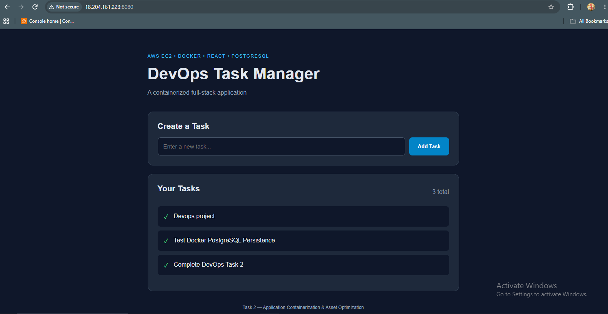
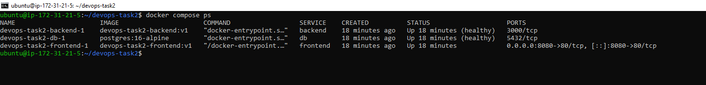
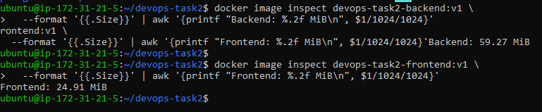

## Project Screenshots

### 1. Deployed Application Dashboard

React-based Task Manager deployed on AWS EC2, accessible through Nginx on port 8080.

### 2. Docker Compose Services

Three running containers: React/Nginx frontend, Node.js backend, and PostgreSQL database. Backend and database health checks are passing.

### 3. Docker Image Optimization

Measured production runtime image sizes:
- **Backend:** 59.27 MiB
- **Frontend:** 24.91 MiB

Multi-stage Dockerfiles separate build dependencies from production runtime components.

### 4. API and Database Connectivity

REST API verification demonstrating successful Nginx routing, backend health, PostgreSQL connectivity, and task retrieval.
## Project Screenshots

### Application Dashboard

### Docker Containers

### Docker Image Optimization

### API Health and Database Connectivity

