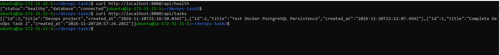

## Measured Docker Image Sizes

| Image | Size |
|---|---:|
| Node.js backend | 59.27 MiB |
| React + Nginx frontend | 24.91 MiB |

Measurements were obtained using `docker image inspect`
on the AWS EC2 Ubuntu instance.

These are final runtime image measurements, not
percentage reductions against single-stage baselines.

## Project Screenshots

### Application Dashboard

### Docker Containers

### Docker Image Optimization

### API Health and Database Connectivity

